# Iconos de inventario de la lámina de Pablo (5/11/2026)

Fuente: `arte/iconos/fuente/lamina_inventario_2026-11-05.webp` (24 objetos, 4 filas). Recortados con `herramientas/recortar_lamina_iconos.py` (fondo blanco roto quitado con alfa suave, sombra del suelo fuera salvo en pluma, seda y frasco de frescor, cuadrado de 256×256 con 14 px de margen). Cada PNG vive en `arte/iconos/<id>.png` (la ruta que ya preveía `docs/PLAN_BASE_DATOS.md`).

**Cómo se ven en el juego:** `Objetos.dibujar` usa el PNG si existe (bolsa, aviso «has cogido…», HUD de consumibles y panel de detalle pasan todos por él); la bolsa lo prefiere al arte viejo de `presentacion/ui/laminas/objeto_<id>.png`. Se reduce una vez a 32/64/128 px según el tamaño pedido (a 40 px usa la copia de 64). Sin PNG, el objeto sigue dibujándose en código como siempre.

**IDs:** 23 de los 24 objetos YA existían y reutilizan su ID; solo `gota_veneno` es nuevo. Los objetos no se han puesto en el mundo ni tienen fuente de botín.

| Miniatura | Ruta | ID | Nombre | Nuevo / reutilizado | Calidad | Uso previsto en recetas |
|---|---|---|---|---|---|---|
| 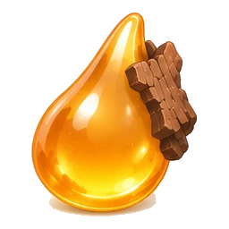 | `arte/iconos/resina.png` | `resina` | Resina | reutilizado | común | Ingrediente (calor, tinta). Va en la Brasa embotellada y en el Pigmento Resina Carmesí. |
| 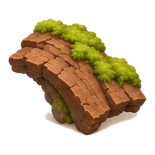 | `arte/iconos/corteza.png` | `corteza` | Corteza | reutilizado | común | Ingrediente (protección, tierra). Va en el Bálsamo protector; sirve a Piel de corteza y Bolsa más honda. |
| 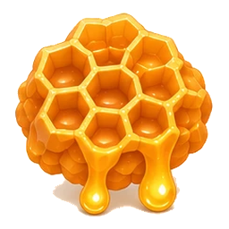 | `arte/iconos/panal.png` | `panal` | Panal | reutilizado | común | Ingrediente (vital, tinta). Sin receta con nombre todavía; cuenta para cualquier receta que pida vital o tinta. |
| 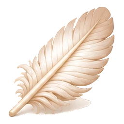 | `arte/iconos/pluma.png` | `pluma` | Pluma | reutilizado | común | Ingrediente (viento, vital). Sin receta con nombre; cuenta para Infusión de brezo (viento) y vital. |
| 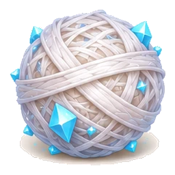 | `arte/iconos/seda.png` | `seda` | Seda de araña | reutilizado | común | Ingrediente (frío, protección). Bordado de escarcha (capa de escarcha) y Frasco de frescor. |
| 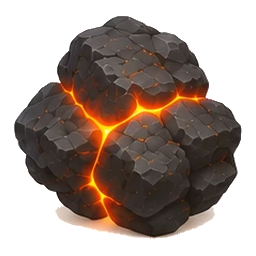 | `arte/iconos/carbon.png` | `carbon` | Carbón | reutilizado | común | Ingrediente (calor, tierra). Cuenta para Pigmento Ocre del Túmulo (tierra) y Tinte de salamandra (calor). |
| 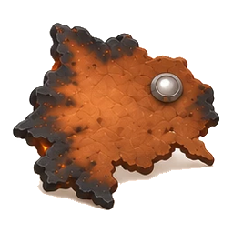 | `arte/iconos/jiron_escudo.png` | `jiron_escudo` | Jirón de escudo | reutilizado | común | Ingrediente (calor, protección). Tinte de salamandra (túnica de salamandra). |
| 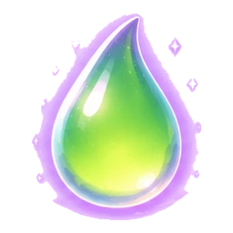 | `arte/iconos/gota_veneno.png` | `gota_veneno` | Gota de veneno | **nuevo** | común | NUEVO. Ingrediente (toxicidad 3). Antídoto (toxico>=2) y Forro de musgo (toxico>=3). |
| 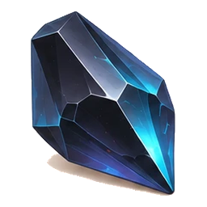 | `arte/iconos/obsidiana.png` | `obsidiana` | Obsidiana | reutilizado | común | Ingrediente (tierra, frío, calor). Cuenta para varias recetas de tierra, frío o calor. |
| 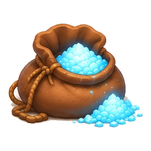 | `arte/iconos/polvo_cristal.png` | `polvo_cristal` | Polvo de cristal | reutilizado | común | Ingrediente (resonante, tinta) y ancla del Pigmento Azul de Eco. |
| 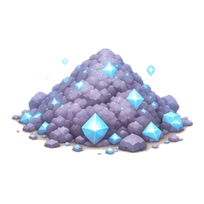 | `arte/iconos/ceniza_geoda.png` | `ceniza_geoda` | Polvo de geoda | reutilizado | común | Ingrediente (resonante, tierra). Frascos de reserva, Hueco de glifo. |
| 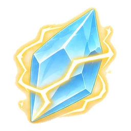 | `arte/iconos/cristal_cargado.png` | `cristal_cargado` | Cristal cargado | reutilizado | común | Ingrediente (resonante, eléctrico). Pigmento Ámbar Volcánico (electrico>=3), Frasco hondo. |
| 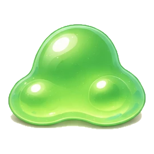 | `arte/iconos/baba_limo.png` | `baba_limo` | Baba de limo | reutilizado | común | Ingrediente (agua, tóxico). Va en el Antídoto. |
| 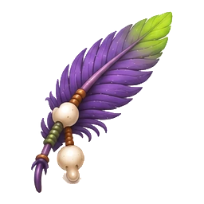 | `arte/iconos/pluma_chaman.png` | `pluma_chaman` | Pluma de chamán | reutilizado | común | Ingrediente (viento, tóxico). Sin receta con nombre; suma toxicidad. |
| 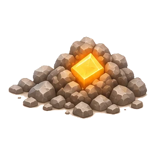 | `arte/iconos/cristal_tierra.png` | `cristal_tierra` | Cristal de tierra | reutilizado | común | Ingrediente (tierra). Pigmento Ocre del Túmulo, Bolsa más honda, Corazón robusto. |
| 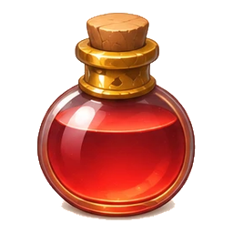 | `arte/iconos/pocion.png` | `pocion` | Poción de vida | reutilizado | común | Consumible (cura 40). Resultado de la receta Poción de vida. |
| 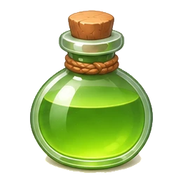 | `arte/iconos/antidoto.png` | `antidoto` | Antídoto | reutilizado | común | Consumible. Resultado del Antídoto (baba de limo + bayas). |
| 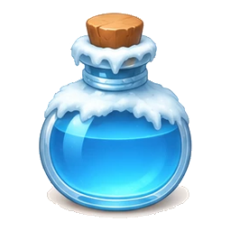 | `arte/iconos/frescor.png` | `frescor` | Frasco de frescor | reutilizado | común | Consumible. Resultado del Frasco de frescor. |
| 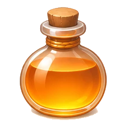 | `arte/iconos/abrigo.png` | `abrigo` | Brasa embotellada | reutilizado | común | Consumible. Resultado de la Brasa embotellada. |
| 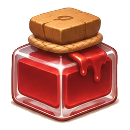 | `arte/iconos/pigmento_carmesi.png` | `pigmento_carmesi` | Pigmento Resina Carmesí | reutilizado | común | Pigmento. Resultado de Pigmento Resina Carmesí. |
| 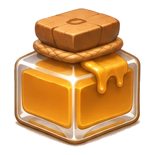 | `arte/iconos/pigmento_ocre.png` | `pigmento_ocre` | Pigmento Ocre del Túmulo | reutilizado | común | Pigmento. Resultado de Pigmento Ocre del Túmulo. |
| 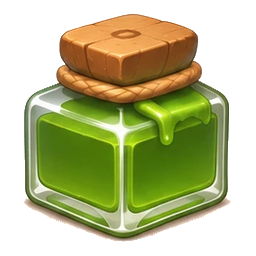 | `arte/iconos/pigmento_musgo.png` | `pigmento_musgo` | Pigmento Verde de Musgo | reutilizado | común | Pigmento. Resultado de Pigmento Verde de Musgo. |
| 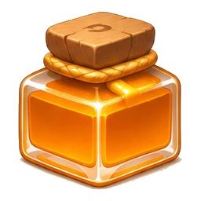 | `arte/iconos/pigmento_ambar.png` | `pigmento_ambar` | Pigmento Ámbar Volcánico | reutilizado | común | Pigmento. Resultado de Pigmento Ámbar Volcánico. |
| 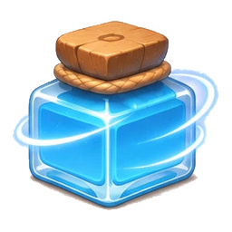 | `arte/iconos/pigmento_eco.png` | `pigmento_eco` | Pigmento Azul de Eco | reutilizado | común | Pigmento. Resultado de Pigmento Azul de Eco. |

## Decisiones de ID (por si Pablo quiere cambiar alguna)

- Fila 4, los cinco tarros cuadrados con corcho y cuerda, de izquierda a derecha rojo, ámbar, verde, naranja y azul con anillo: son los **cinco pigmentos** (carmesí, ocre, musgo, ámbar volcánico, azul de eco), que casan uno a uno con su color.
- Fila 3, las cuatro pociones redondas: roja = `pocion` (Poción de vida), verde = `antidoto`, azul con escarcha = `frescor`, naranja = `abrigo` (Brasa embotellada, #FF9E47). `pocion_grande` no tiene icono nuevo y sigue dibujada en código.
- Carbón con grietas de lava = `carbon`; roca de grietas rojas podría ser también `basalto`, que conserva su arte viejo.
- Pila de polvo gris con cristales azules = `ceniza_geoda` (Polvo de geoda); saco de polvo azul = `polvo_cristal`; cristal con rayos amarillos = `cristal_cargado`.
- Montón de piedras con cristal ámbar = `cristal_tierra` (color #B38C4D). Si Pablo lo quiere como material propio (otra cosa que el cristal de tierra), hay que crear el objeto.
- Gota verde con aura morada = `gota_veneno`, NUEVO: categoría animal, común, material de receta con etiqueta `toxico` (potencia 3), sin efecto jugable.
- Limo verde = `baba_limo`. Pluma morada con cuentas = `pluma_chaman`. Cuero chamuscado con remache = `jiron_escudo`. Cristal oscuro = `obsidiana`.
